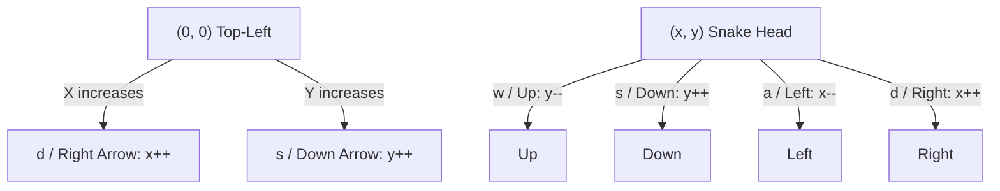
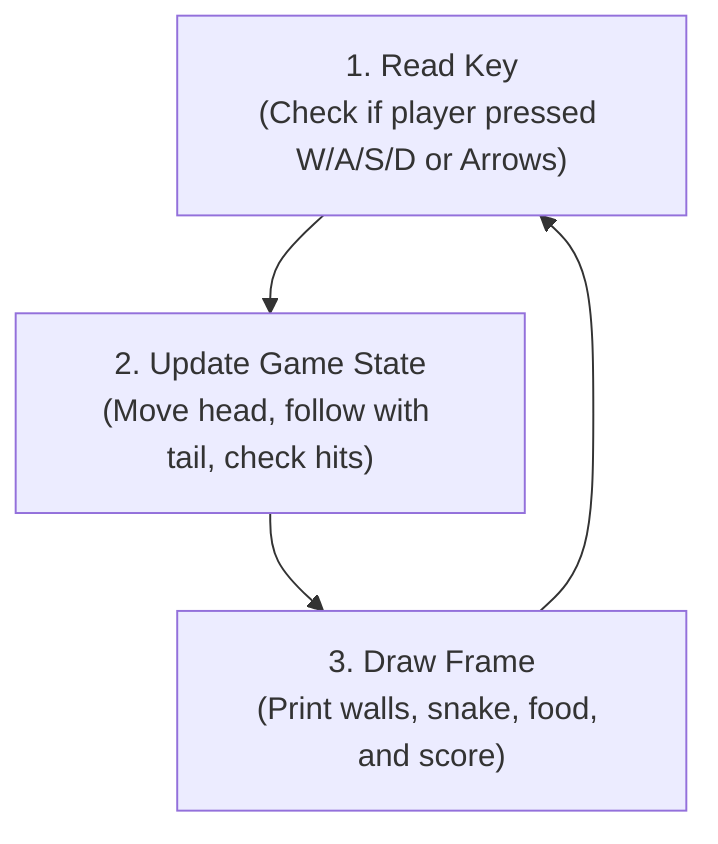

# 🐍 Snake Game in C

A classic Snake game for the terminal, written in pure C without any external graphics libraries. Built to learn C fundamentals, 2D grid coordinates, game loops, and terminal handling.


---

## 📐 1. How the Grid Works

The terminal screen works like a 2D matrix:

- **Top-left corner** is `(0, 0)`.
- **X (columns):** increases going right (`0` to `width - 1`).
- **Y (rows):** increases going down (`0` to `height - 1`).



---

## 🔄 2. How the Game Runs

The game runs inside a loop with three main steps each frame:



### Controls

| Key | Action | What it does |
|---|---|---|
| `w` / `W` / `2` / `↑` | Move Up | Moves up one row (`y--`) |
| `s` / `S` / `8` / `↓` | Move Down | Moves down one row (`y++`) |
| `a` / `A` / `4` / `←` | Move Left | Moves left one column (`x--`) |
| `d` / `D` / `6` / `→` | Move Right | Moves right one column (`x++`) |
| `p` / `P` | Pause | Pauses or unpauses the game |
| `q` / `Q` | Quit | Exits the game cleanly |
| `y` / `Y` | Play Again | Restarts a new round after game over |

---

## 🖼️ 3. Drawing the Screen

Every frame, the game loops through each row (`i`) and column (`j`) to print the right character:

| Spot | When | Character |
|---|---|:---:|
| Wall | On the edges (`i == 0`, `i == height - 1`, `j == 0`, `j == width - 1`) | `#` |
| Snake Head | At `(x, y)` | `O` |
| Food | At `(foodX, foodY)` | `*` |
| Tail Segment | Matches any coordinate in `tailX` / `tailY` | `o` |
| Empty Space | Everywhere else | ` ` |

---

## 🗺️ 4. Project Roadmap

- [x] **Milestone 1:** Draw the boundary box using nested loops.
- [x] **Milestone 2:** Place snake head in the center of the board.
- [x] **Milestone 3:** Add movement loop so the head can move with keys.
- [x] **Milestone 4:** Add food, score counter, and wall collision.
- [x] **Milestone 5:** Add growing tail, self-collision, and smooth real-time movement.
- [x] **Milestone 6:** Add difficulty speeds and save high score to a file.
- [x] **Milestone 7:** Add replay option on game over and organize code into helper functions.

---

## ⚙️ 5. How to Compile and Run

### What you need:
- GCC or Clang on Linux / macOS

### Compile:
```bash
gcc -Wall -Wextra -pedantic boundary.c -o snake
```

### Run:
```bash
./snake
```

---

## 🤝 Contributing

Contributions, issues, and ideas are welcome! Feel free to check the issues page or open a pull request.

## 👤 Author

**Suleman Ahmed Shuvo**  
Roll: 43 | Batch: 19  
Dept. of Computer Science & Engineering  
Sylhet Engineering College  

---

## 📝 Changelog

### [1.0.0] - High score, difficulty, replay, and code cleanup
- Added persistent high score saved to `highscore.txt`.
- Added difficulty speed selector at start (Easy, Medium, Hard).
- Added play again (`y`/`n`) option on game over so you don't have to restart the binary.
- Split the game into clean, readable helper functions (`drawBoard`, `spawnFood`, `chooseDifficulty`, `loadHighScore`, etc.).

### [0.5.0] - Real-time movement & game feel
- Switched to terminal raw mode so the snake moves in real-time without pressing Enter.
- Added arrow keys support alongside WASD and numpad.
- Stopped screen flicker by moving cursor back to top instead of clearing the screen every tick.
- Blocked turning directly backwards into the tail.
- Added pause and resume with `P`.
- Fixed bug where a typo or unhandled key caused the snake to bite itself.
- Made sure food never spawns on top of the snake's body.

### [0.4.0] - Snake body and tail collision
- Added tail arrays (`tailX`, `tailY`) so each body part follows the one ahead of it.
- Snake grows by 1 segment whenever it eats food.
- Added game over if the snake hits its own tail.

### [0.3.0] - Food, score, and walls
- Game ends if you hit the wall.
- Added numpad keys (`2`, `8`, `4`, `6`) for controls.
- Spawn food randomly on the board using `rand()`.
- Added score counter that increases when food is eaten.

### [0.2.1] - Screen clear and input fix
- Cleared terminal between frames to stop endless scrolling.
- Flushed input buffer so extra newlines don't trigger double frames.
- Added support for capital movement keys (`W`, `A`, `S`, `D`).

### [0.2.0] - First playable movement
- Added the main game loop with `while(1)`.
- Allowed moving the snake head with `w`, `a`, `s`, `d`.

### [0.1.0] - Initial board and head
- Drew static `#` box with nested loops.
- Placed initial snake head at center (`x=10, y=5`).

---

## 📄 License

This project is licensed under the MIT License — see the [LICENSE](LICENSE) file for details.
